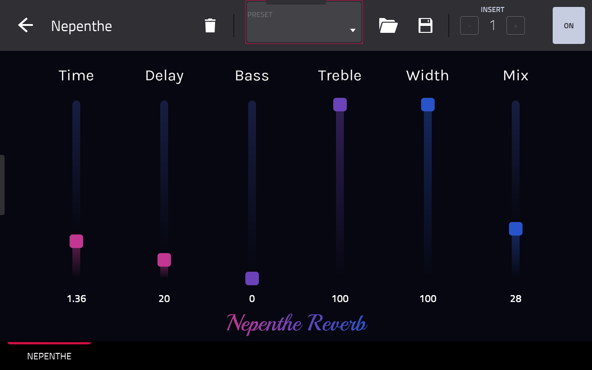

# Nepenthe Reverb for MPC OS

A port of **Nepenthe** by [Amalgamated Signals](https://amalgamatedsignals.com/nepenthe), a smooth, transparent
velvet-noise reverb, to Akai MPC OS standalone devices as a VST2 insert effect, built on the
[Open MPC](https://github.com/open-mpc/mpc-vst-plugins) wrapper. Not affiliated with Amalgamated Signals or with Akai.



- 1000 randomly placed echoes per side over one second, sustained by a feedback loop: no delay-line network.
- Upstream's six controls on one page, upstream's look (vertical sliders), six Q-Links: **TIME** (decay to -60 dB,
  0.5..8 s), **DELAY** (pre-delay, 0..200 ms), **BASS**, **TREBLE**, **WIDTH**, **MIX**.
- Sound unchanged: upstream's DSP, with the reverb's inner loops rewritten in NEON and checked bit-identical to upstream.
- Gen1 (armv7: Live, Live II, One, X, Key 61/37, Force) and Gen2 (aarch64) builds.

## Install
Download the zip for your MPC from [Releases](../../releases): `-mpc-armv7` for Gen1, `-mpc-aarch64` for Gen2.

- **MPC OS 3.10.1 and later** (Preferences, Enhancements, VST2 Support on): copy the folder
  `portable/OpenMPC - VST - Nepenthe/` from the zip into `VST2 Plugins/` at the root of a drive (on a Gen1 internal
  drive: `/sdcard/VST2 Plugins/`), then restart MPC. Or, as root: `sh install.sh -t "/sdcard/VST2 Plugins"`.
- **Earlier MPC OS** (root needed): `sh install.sh` from the unzipped folder; see the zip's `INSTALL.md`.

## Build and test
Needs Docker with arm/arm64 emulation (WSL) and a checkout of `open-mpc/mpc-vst-plugins` next to this repo:
```
python3 vst/skin/make_skin.py                               # skin art and vst/layout.conf
../mpc-vst-plugins/tools/build_port.sh vst/vst.json all     # vst/build/ (armv7) and vst/build/aarch64/
../mpc-vst-plugins/tools/test_port.sh vst/vst.json          # host test under ASan/UBSan (also: ... aarch64)
g++ -std=gnu++17 -O2 -ffp-contract=off -Isrc/shim -Iupstream/Source -I../mpc-vst-plugins/wrapper \
    tests/ref_check.cpp tests/ref_tu.cpp src/engine.cpp src/Parameters.cpp src/opt/Reverberator.cpp \
    src/opt/Echoes.cpp upstream/Source/{Delay,Equalizer,Mixer,Timer}.cpp -o tests/out/ref_check && tests/out/ref_check
```

## Status (2026-11-22)
Offline: `tests/ref_check.cpp` shows the reverb bit-identical to upstream's on x86 and armv7 (NEON), in 128-, 100- and
64-frame blocks, and the measured T60 following TIME (0.50 s, 2.21 s, 4.14 s for 0.50, 2.20, 4.12 s); host test PASSED
on x86 (ASan/UBSan) and aarch64.
Device, MPC Live Gen1, MPC OS 3.10.1: installed from the portable folder, listed in the plugin browser, loaded as an
insert (screenshot above). Bench: mean 10.0 %, p99 10.8 % of an audio block while playing; 16.0 % p99 while Q-Links
sweep every parameter (WARN: each TIME change recomputes the 2000 echo gains exactly as upstream does). Gen2: offline only.

## Licence
GPL-3.0 (`LICENSE`), as upstream. Fonts in `vst/skin/fonts/`: Karla and Playball, SIL Open Font License.
